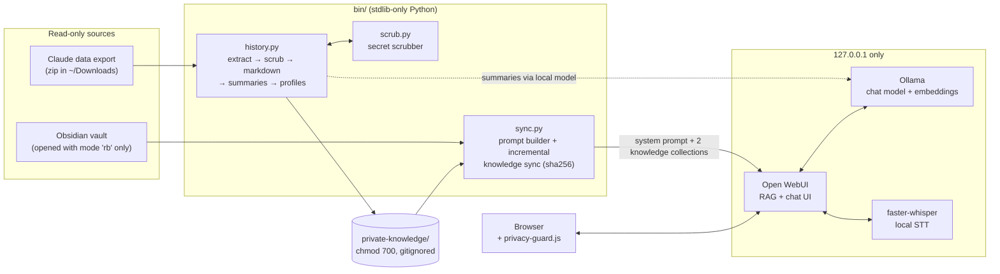

# Jarvis

[](https://github.com/Rudra-C-Patel/jarvis/actions/workflows/ci.yml)


**A private, fully local LLM assistant that answers questions about my life using RAG over my Obsidian notes and a secret-scrubbed copy of my AI-chat history. No cloud APIs, no accounts, nothing leaves the laptop.**

## Why it exists

My notes, plans and two years of AI-chat history are the most useful context about my life, and also the last things I'd paste into a cloud chatbot. I wanted an assistant that could use all of it and was private by construction: local model, local embeddings, local speech-to-text, and code-level guards rather than settings I'd have to trust myself to get right.

## Architecture



**Two kinds of context reach the model:**

1. **Always-on:** `sync.py` builds a system prompt from the persona file, generated profile notes, a computed RECENCY block, and priority notes (home note, personal area, newest Daily notes) inlined verbatim. It stays inside a token budget (default 10,000) by dropping the oldest Daily notes first.
2. **Retrieved:** every other note, plus each scrubbed past conversation, is mirrored into Open WebUI knowledge collections. The top-K passages (`RAG_TOP_K`) are retrieved for every question and cited by source path.

## Features

- **Read-only vault sync.** The vault is only ever opened with mode `"rb"`. Sync is incremental by content hash, mirrors deletions, and splits chats over 400 KB at message boundaries for indexing.
- **Chat-history pipeline.** It ingests classic and multi-part Claude exports, converts each conversation to markdown, scrubs it, and summarizes it on the local model (at most 8 evenly spaced parts per long chat, first and last always included). It also builds three profile notes: projects, life context, and how I want to be helped.
- **Recency resolution.** Dated bullets and headings are collected across the vault, and the newest dated entry wins on conflicts. If the newest Daily note is more than 7 days old, the model is told to warn first.
- **Hallucination guards in code.** Duplicate-bullet removal, hand-maintained regex corrections that survive regeneration, an optional GPA filter, and a neutralizer that collapses bullets matching a local, gitignored term list (`private-knowledge/profile/neutralize.txt`, empty by default) in the always-on profile are applied after generation, not left to the model.
- **Local voice.** Open WebUI's built-in faster-whisper handles speech-to-text. A browser guard removes cloud speech APIs and network TTS voices.
- **`/checkin` preset.** Three questions about your day, then a Daily note drafted for you to paste.
- **Terminal client.** `bin/ask.py "question"` goes through the same prompt and retrieval as the browser.

## Privacy and safety design

| Guarantee | How it's enforced |
|---|---|
| **Local only** | `sync.py` exits unless the Open WebUI URL is `127.0.0.1`/`localhost`. All LLM calls go to Ollama on `127.0.0.1:11434`. `jarvis.env.example` turns off OpenAI-compatible APIs, web search, community sharing, update checks, OAuth, telemetry and Ollama cloud models. CORS is restricted to Jarvis's own origin. |
| **Vault can't be written** | Vault files are opened read-only, and both scripts refuse to run if any of their output paths resolve inside the vault (or other protected, git-synced folders). |
| **Secrets never reach the index** | `scrub.py` runs on every converted chat *before* it's written. It covers 27 named patterns (provider API keys, bot tokens, JWTs, URL credentials, credential assignments, OTP and recovery codes, SSNs, bank account numbers), plus Luhn-checked card numbers, mod-97-checked IBANs and an entropy-gated generic token rule. It returns **counts only, never values**. Profiles are scrubbed a second time before they're written. |
| **Raw export is temporary** | The unscrubbed export is extracted to a `0700` directory with path traversal stripped, then deleted as soon as conversion finishes. Derived files are `0600`. |
| **No speech leaves the browser** | `web/privacy-guard.js` deletes `SpeechRecognition`/`webkitSpeechRecognition` (Chrome streams that audio to Google) and limits TTS to `voice.localService === true`. Each sync also pins per-user audio settings back to the local engines. |
| **Approval by design** | Jarvis never writes to the vault or acts on anything. It drafts text (for example a Daily note) for you to paste yourself. |
| **Nothing private in git** | `.gitignore` covers `data/`, `private-knowledge/`, `logs/`, `jarvis.env`, `system_prompt.md` and credential patterns. Only `*.example` templates are committed. |

## Setup

Requirements: macOS or Linux, [Ollama](https://ollama.com), [Open WebUI](https://github.com/open-webui/open-webui) (installed as a `uv` tool), Python 3.9+ (macOS system Python works). The pipeline itself is standard library only.

```bash
git clone https://github.com/Rudra-C-Patel/jarvis ~/jarvis && cd ~/jarvis
cp jarvis.env.example jarvis.env            # set JARVIS_BASE_MODEL, JARVIS_USER_NAME, ...
cp system_prompt.example.md system_prompt.md  # write your own persona
mkdir -p data && python3 -c "import secrets; print(secrets.token_hex(32))" > data/secret_key && chmod 600 data/secret_key
ollama pull <your-chat-model> && ollama pull qwen3-embedding:0.6b
alias jarvis=~/jarvis/bin/jarvis
```

Point `JARVIS_VAULT` at your Obsidian vault (default `~/PersonalBrain`).

## Usage

```bash
jarvis                    # start Ollama + Open WebUI, sync the vault, open the chat
jarvis sync [--low]       # ingest a new Claude export → summaries → profiles → index
jarvis history status     # counts, redaction totals, whether a newer export is waiting
jarvis stop | status | logs
bin/ask.py "what's still open this week?"
python3 bin/scrub.py --selftest
```

`--low` runs batch jobs under `taskpolicy -b` and moves the Ollama runners to background QoS. It's slower, but cooler and quieter on a laptop.

## Tests

```bash
pip install -r requirements-dev.txt && python -m pytest -q
```

**63 pytest tests** cover the scrubber (every synthetic secret redacted, every benign sample untouched, Luhn/IBAN checksums, idempotence), the sync logic (query-block stripping, priority-note selection, token-budget trimming, recency ordering, stale-Daily detection, message-boundary splitting) and the history pipeline (zip path traversal, speaker labelling, code-level profile rules). The scrubber also has a built-in **34-case** self-test (18 synthetic secrets, 16 look-alike benign strings). CI runs both on Python 3.12 and 3.13.

## Limitations

- **Local-model quality is the ceiling.** Summaries and profiles come from a laptop-sized model, which sometimes files a multi-topic chat under several projects. Treat the generated profiles as a digest and fact-check them; the vault is the source of truth.
- **The scrubber is pattern-based.** It catches known formats and high-entropy tokens, not every possible secret. An unknown low-entropy password in prose can get through.
- **Single user, no login.** Open WebUI runs with `WEBUI_AUTH=False` on localhost, so anyone with access to the OS account can open the chat.
- **Built for one setup.** The launcher is zsh and macOS-specific (`taskpolicy`, `open`), and the summarizer prompts are written for one user.
- **Slow on purpose.** Running fully local means long first answers and multi-hour batch summarization for a full history.

## What I learned

- **Grounding beats speed.** In a side-by-side bake-off on real vault questions, the bigger, better-known model confidently cited a Daily note for a "fact" that note didn't contain. The one I chose flagged stale notes instead. For an assistant that talks about your life, an invented fact is the worst failure.
- **Test the retrieval path, not just the answers.** In v1.0 vault search silently never ran: that Open WebUI version only auto-searches attached knowledge in `legacy` function-calling mode, so answers came only from the inlined notes. Now I check that citations actually come back.
- **Real data finds the gaps in a scrubber.** Synthetic tests passed, but the real export had tokens inside `/bot<token>/` URLs and app-specific `xx_admin_…` tokens the first version missed. Every miss became a regex plus a test case, and false positives (table numbers, ms timestamps, tracking URLs, deployment IDs) became benign cases.
- **Models upgrade "advised" to "done".** Summaries turned "Claude advised rotating the key" into "key rotated". The prompts now force a split between done and advised, and the rules I care about are enforced in code after generation.
- **Privacy is mostly about defaults you don't see.** Chrome's speech recognition quietly streams audio to Google, so "local voice" needed a browser-side guard, not just a local Whisper server.

## License

[MIT](LICENSE)
